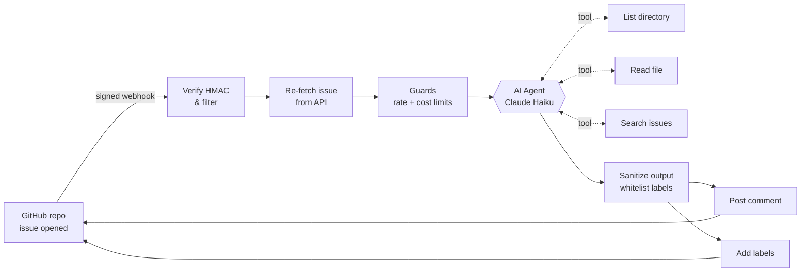

# kai-hausmeister: AI agent for GitHub issue triage, built on n8n

**An agentic n8n workflow that triages every new GitHub issue in seconds.** It reads the codebase, finds duplicates, labels the issue and posts a structured triage comment. It is self-hosted and secured against prompt injection, and costs about one cent per issue.


> *Hausmeister* (German): the caretaker who keeps a building in order. This one keeps an issue tracker in order.

---

## Why

Maintainers of public repos spend hours on first-line triage: "is this a bug?", "where in the code?", "didn't we fix this already?", "what is missing from the report?". Most AI triage templates only classify the issue text. **kai-hausmeister is a real agent.** It uses tools to browse the repository and search past issues, and only then writes its answer. Its claims point to files it actually read.

## What it does

When an issue is opened, within seconds and without a human:

- **Classifies** it: bug, feature request, question, documentation, unclear or spam, with a confidence level.
- **Locates the affected code**: browses the repo tree and reads the relevant files through the GitHub API, with no clone.
- **Detects duplicates** by searching open *and* closed issues, so earlier fixes are found too.
- **Asks for missing information**: versions, reproduction steps, logs.
- **Suggests next steps** for maintainers.
- **Applies labels**, only from a whitelist and at most 3.

<details>
<summary>Example triage comment (illustrative)</summary>

```markdown
**Type:** bug (confidence: high)
**Affected area:** `cli/lib/install.js`, `templates/rules/`
**Summary:** Installing the plugin on Windows fails because paths are joined with "/".
**Missing information:** OS version and the full error log.
**Possible duplicates:** #42 Install fails on Windows paths (closed)
**Suggested next steps:**
- Check whether the fix from #42 regressed
- Use path.join in the installer
- Add a Windows job to CI

---
Automated first triage by kai-hausmeister (AI agent). Not a maintainer decision. Labels set: `bug`, `cross-platform`.
```
</details>

## Architecture



Built with **n8n** (self-hosted, Docker Compose behind Caddy/HTTPS), the n8n **AI Agent node** with LangChain-style tools, **Anthropic Claude**, and the **GitHub REST API**. For triage, the target repository needs no code changes, only a webhook.

Node-by-node description: [workflows/README.md](workflows/README.md) · system design: [docs/architecture.md](docs/architecture.md)

## Built for public repos: security by design

Anyone can open an issue, so every issue is treated as a possible prompt injection attack. Several independent layers limit what can go wrong:

| Layer | What it does |
|---|---|
| **Signed webhooks** | HMAC SHA-256 check on the raw body. Forged requests fail. |
| **Trusted input only** | The issue is re-read from the GitHub API, not taken from the webhook payload. |
| **Untrusted-data prompt** | Issue text is marked as data, never instructions, in the system prompt. |
| **Read-only tools** | The agent can only list, read and search. It cannot write code. |
| **Least-privilege token** | Fine-grained, one repo, `Issues: write` + `Contents: read`. Worst case is a bad comment, never a code change. |
| **Output sanitizing** | Strips images, external links and @mentions. Labels must be on a whitelist. |
| **Hard limits** | Max 10 agent iterations, 20 runs/day, 3 issues per author/day, $1/day spend cap. No bots, no PRs. |
| **Isolation** | n8n runs in its own container with only its own volume. The API is not reachable from outside. |

## Production-grade operations

- **GitOps for n8n**: the workflow JSON in this repo is the source of truth. Merged changes are deployed to the running instance through the n8n public API. Same workflow id, same webhook URL, no manual import ([D014](plan/decisions/D014-deploy-workflow-via-api.md)).
- **Secret-safe exports**: `workflows/sanitize.py` removes instance data and refuses to write if a secret or an email address is left. CI blocks secrets as well.
- **Backups**: daily encrypted off-server backup, tested.
- **Measured cost**: about $0.01 per triage, plus a spend limit on the provider side.
- **Documented decisions**: 14 architecture decision records with options, pros and cons ([plan/](plan/INDEX.md)).

## Roadmap

| Phase | Capability | Status |
|---|---|---|
| 1 | Agentic triage comment (code-aware) | ✅ live |
| 2 | Labels + duplicate detection | ✅ live |
| 3 | **Autonomous fix**: a maintainer adds a fix label, Claude Code runs in an isolated sandbox (GitHub Actions VM or own sandbox server, under evaluation) and opens a pull request for review ([D015](plan/decisions/D015-phase3-runtime.md)) | 🛠 planned |
| – | Research: n8n vs GitHub Actions, where each fits best ([F10](plan/features/F10-n8n-vs-gh-actions.md)) | 🔍 next |
| – | Same workflow on n8n Cloud, comparison | 🗓 later |

## Use it on your repo

1. Run n8n: [docker/](docker/README.md) (Docker Compose + Caddy, SQLite).
2. Import [`workflows/triage.json`](workflows/triage.json), set the GitHub and Anthropic credentials and the webhook secret, then publish.
3. Add a webhook in your repo (`Issues` events, same secret).
4. Adapt the system prompt and the label whitelist to your project.

Full steps: [workflows/README.md](workflows/README.md#first-setup-new-instance).

## Repository layout

```
workflows/   n8n workflow (template) + sanitize script
docker/      docker-compose.yml, Caddy site, .env.example
docs/        architecture and security
plan/        features, decision records (ADRs), risks, research, change log
```

## Author

Built by **[easingthemes](https://github.com/easingthemes)**: AI agents, agentic workflows and n8n automation for engineering teams.

More agentic work:
- [dx-aem-flow](https://github.com/easingthemes/dx-aem-flow): AI development plugins for Claude Code & Copilot CLI, from requirements to PR, with autonomous CI agents
- [aem-mcp-server](https://github.com/easingthemes/aem-mcp-server): MCP server for Adobe Experience Manager
- [ki-bundestag](https://github.com/easingthemes/ki-bundestag): multi-agent AI parliament simulation
- [ssh-deploy](https://github.com/easingthemes/ssh-deploy): GitHub Action for rsync deployments, 1.3k★

Want this, or a custom agentic workflow, for your team? See the [portfolio on GitHub](https://github.com/easingthemes) and get in touch.

## License

[MIT](LICENSE)

---

<sub>Keywords: n8n AI agent · GitHub issue triage · agentic workflow · LLM automation · Claude · duplicate issue detection · auto-labeling · prompt injection defense · self-hosted n8n · GitOps for n8n · open-source maintainer tools</sub>
